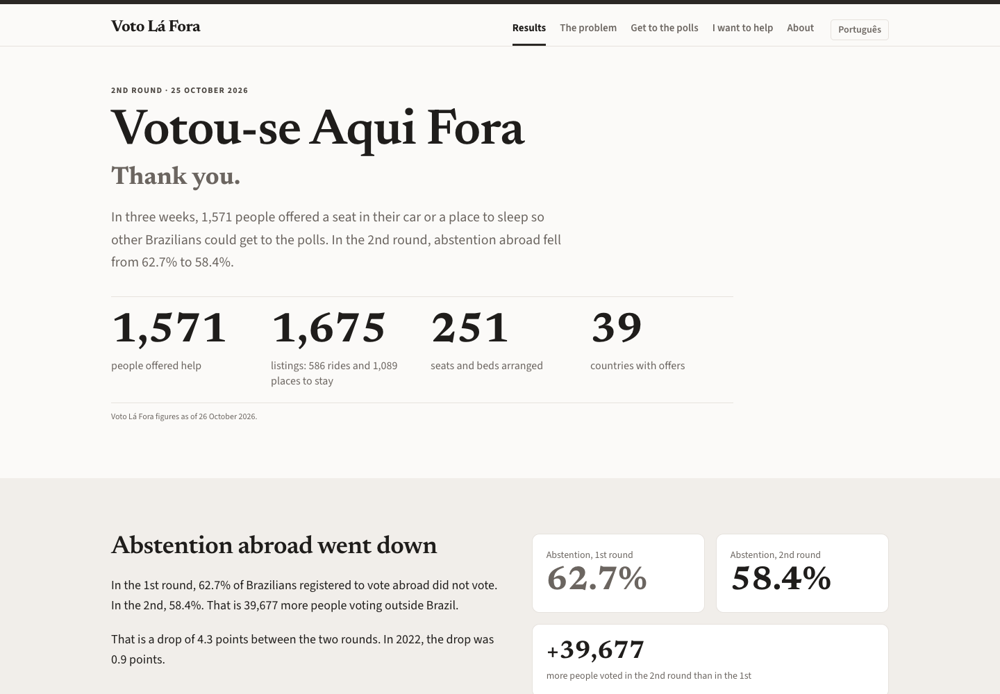
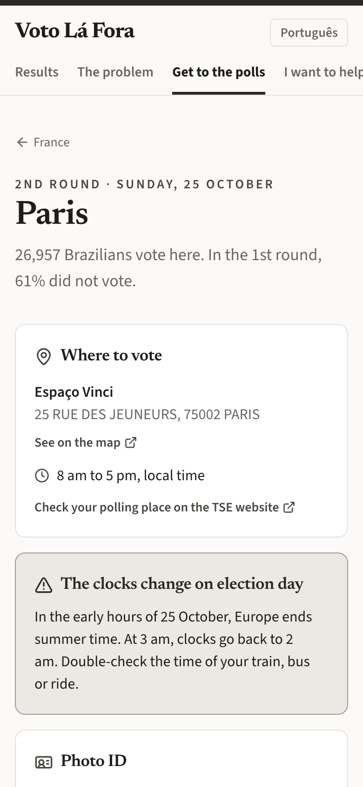
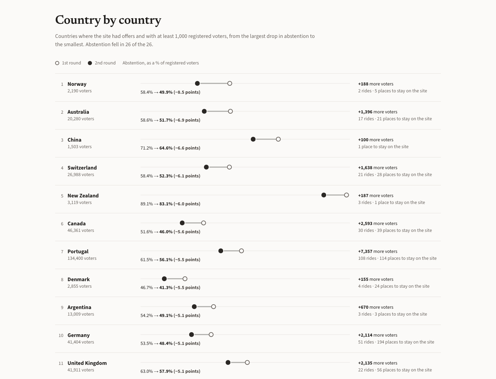
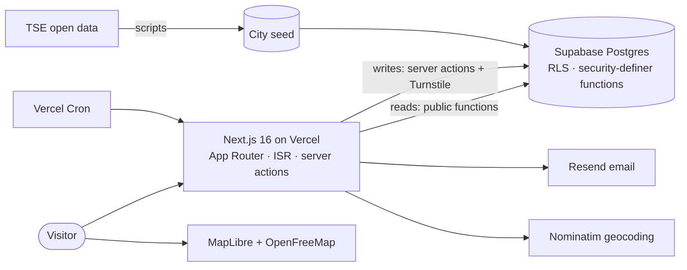

# Voto Lá Fora

**A non-partisan noticeboard that helped Brazilians living abroad get to the polls for the 2026 presidential runoff.** People with a spare seat in their car or a spare bed offered it; voters who lived far from their polling station found one. Built and shipped in two days, used by 1,500+ volunteers in 39 countries over three weeks.

🌐 [votolafora.com.br](https://votolafora.com.br) (Portuguese) · [votolafora.com.br/en](https://votolafora.com.br/en) (English)



## The problem

Brazilians abroad vote in person, at a handful of polling places run by embassies and consulates. In the first round of the 2026 presidential election (4 October), **6 in 10 of them did not vote**:

| | Registered voters | Abstention, 1st round |
|---|---|---|
| Brazilians abroad | 916,534 | **62.7%** |
| Brazil as a whole | 158,745,502 | 21.1% |

Distance is a large part of it:

- There are only **164 polling places in 102 countries**, usually one or two per country. France has Paris and Marseille; Spain, Madrid and Barcelona; Italy, Milan and Rome.
- From Toulouse, the nearest polling place is 320 km away; from Seville, 390 km; from Palermo, 430 km. Many voters face a train ticket of €100 or more and a whole day of travel and queuing.
- Abstention abroad had grown from 56.2% in 2022 to 62.7%. Since 2022 the number of registered voters abroad grew by 32%, but turnout by only 12%.
- Where a polling place is within reach (the Netherlands, Belgium, Ireland), abstention sits around 50%. Where it is not (Spain, Italy, the United States), it goes above 68%.

The runoff was on 25 October, **less than three weeks away**.

## What it does

Voto Lá Fora connects two groups, city by city:

- **People who can help** publish a ride (date, departure city, seats) or a place to stay (neighbourhood, nights, capacity), with a light account: first name, email and a one-time code. No password, no phone number.
- **Voters who need help** pick their country and polling city, browse the offers and send a request with no account at all. The person offering confirms or declines. Only after confirmation does their WhatsApp number become visible to the person offering, so they can arrange the details directly.

Around that core: a "notify me" alert when offers appear in a city, a map of where people are waiting for rides, group trips by train or bus (each person buys their own ticket), moderation and reporting, and transactional emails in Portuguese and English.

The site never handles payments, never transports or hosts anyone, and never asks how anyone votes. It is open to every voter.



## Impact

| | |
|---|---|
| People who offered help | **1,571** |
| Listings | **1,675** (586 rides, 1,089 places to stay) |
| Confirmed contacts | **201**, for **251** seats and beds |
| Countries with offers | **39** |
| Press coverage | TV Cultura, Folha de S.Paulo, Valor Econômico, DW Brasil (republished by g1 and UOL), PÚBLICO, DN Brasil, Revista Entre Rios, ICL Notícias |

In the runoff, abstention among Brazilians abroad fell from **62.7% to 58.4%**: **39,677 more people voted** outside Brazil. Between the two rounds of 2022, the drop had been 0.9 points; in 2026 it was 4.3. Abstention fell in all 26 countries where the site had offers and at least 1,000 registered voters, and it fell more in cities with more listings.

That is a correlation, not proof that the site caused the drop: 251 arranged seats and beds are a small share of 39,677 additional voters, and the places where the Brazilian community was most mobilised are also where most people offered rides. The [results page](https://votolafora.com.br/en) says so explicitly.



## Engineering highlights

- **The database enforces the rules.** Every write with a business rule goes through a Postgres function (`security definer`, fixed `search_path`); tables have row-level security and no direct grants. Visitors only read minimal public views through functions. Admin actions check the caller inside the database, not only in the UI. **126 pgTAP assertions** cover access rules, request lifecycles, seat counting, bans and abuse limits, and run both on the Supabase stack and on plain Postgres 16.
- **Privacy by design.** First name only in public; offerers never give a phone number; a requester's WhatsApp is revealed only to the one person they chose, after confirmation; IP addresses are stored only as salted hashes for rate limiting; everything is deleted on a fixed date written in the privacy policy (GDPR, with the CNIL as authority).
- **Legal constraints as product requirements.** Brazilian electoral law forbids offering free transport or any advantage tied to a vote. Under review by lawyers, the site became a pure noticeboard: it never says "free", never handles money, never asks about votes, makes every offerer and requester confirm a liability notice (checked on the server), and shows an independence notice on every page.
- **Official open data pipeline.** Polling places come from the Electoral Court's (TSE) open data on voters per polling location; scripts turn it into the city seed. First- and second-round results are read from the TSE's signed result files, city by city, for the abstention analysis.
- **Geocoding that copes with free text.** Departure cities typed by users ("Bethel", "near Salamanca, but I can pick up in…") are cleaned and geocoded with OpenStreetMap's Nominatim, keeping only settlement-level results and choosing the candidate nearest to the destination. Results are cached in the database.
- **Maps.** MapLibre GL with OpenFreeMap tiles: ride arcs per country (dashed for group trips) and a bubble map of where people are still waiting for a ride.
- **Fast and cheap at peak.** Public pages are statically rendered with time-based and on-demand revalidation (every write revalidates the affected city in both languages). The whole site ran for about US$40 a month (Vercel Pro and Resend Pro, Supabase free tier).
- **Bilingual.** All pages live under a `[lang]` segment; a proxy serves Portuguese without a prefix and English under `/en`, with hreflang alternates and a sitemap.
- **Email.** Transactional email through Resend, with retries and batching, plus two one-off campaigns protected by an idempotency table so nobody is emailed twice. The post-election email carries a personal, hashed token that opens a story form without any login.

### Architecture



**Stack:** Next.js 16 (App Router, React 19, TypeScript), Tailwind CSS 4 and shadcn/ui, Supabase (Postgres, Auth, RLS), pgTAP, Resend, Cloudflare Turnstile, MapLibre GL with OpenFreeMap, Vercel.

## Repository layout

```
src/app/[lang]/        Pages, in Portuguese and English (results, countries, cities, offers, requests, moderation)
src/app/actions/       Server actions: every visitor write, with Turnstile and validation
src/app/api/cron/      Daily job (expiry, reminders, alerts, data retention) and one-off email sends
src/lib/               Data access, email templates, geocoding, formatting, SEO
src/content/           Results data and press coverage shown on the home page
supabase/migrations/   Schema, policies and every database function
supabase/tests/        pgTAP tests
content/dados/         TSE data (polling places, 1st and 2nd round results) with sources
content/legal/         Terms, privacy policy, safety guide (Portuguese and English)
scripts/               Data pipeline (TSE → cities), geocoding, icons, test runners
```

Code comments and commit messages are in Portuguese, the site's main language.

## Running it locally

Requirements: Node.js 20 or later, pnpm and Docker.

```bash
pnpm install
pnpm db:start                 # local Supabase (Docker); prints the URL and keys
cp .env.example .env.local    # fill in the URL and keys printed above
pnpm db:reset                 # schema, polling cities and fictitious demo data
pnpm dev                      # http://localhost:3000
```

- Database studio: http://127.0.0.1:54323
- Test inbox for all emails, including login codes: http://127.0.0.1:54324. The demo user `marina.demo@exemplo.local` is an admin.
- Turnstile test keys are listed in `.env.example`. Without `RESEND_API_KEY`, emails go to the local inbox.

| Command | What it does |
|---|---|
| `pnpm db:test` | pgTAP tests on the local Supabase |
| `pnpm db:test:pg` | The same tests on a plain Postgres 16 container |
| `pnpm db:types` | Regenerates the database TypeScript types |
| `pnpm typecheck && pnpm lint && pnpm build` | Full check before deploying |
| `node scripts/tse-locais.mjs` | Downloads the TSE polling-place file and extracts the abroad section |
| `node scripts/build-cidades.mjs` | Rebuilds the city seed from the TSE data |

## Data sources

All electoral figures come from Brazil's Superior Electoral Court (TSE): official results of the 2026 first round (election 6257) and runoff (6258) for president, and the 2022 open results for comparison, all for the abroad constituency ("ZZ"). Details, file paths and caveats are in [`content/dados/README.md`](content/dados/README.md).

## License

The code is released under the [MIT License](LICENSE). The TSE data is public. The press videos shown on the live site belong to their broadcasters and are not included in this repository.

## Thanks

Bárbara Rangel, for taking the site to cultural centres, restaurants and community spaces in several countries, and for the posters. Pedro Corgozinho, Ana Clara Jansen and Tatiana Cavalcant, for the legal work that kept the site within electoral law. Madelyn Romberg, for her ideas on system design and user experience. And everyone who offered a seat, opened their home, asked for a place or shared the link.

Built by [Pedro Morel Rosa](https://github.com/pmorelr).
